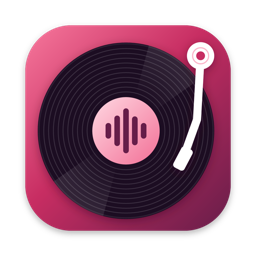
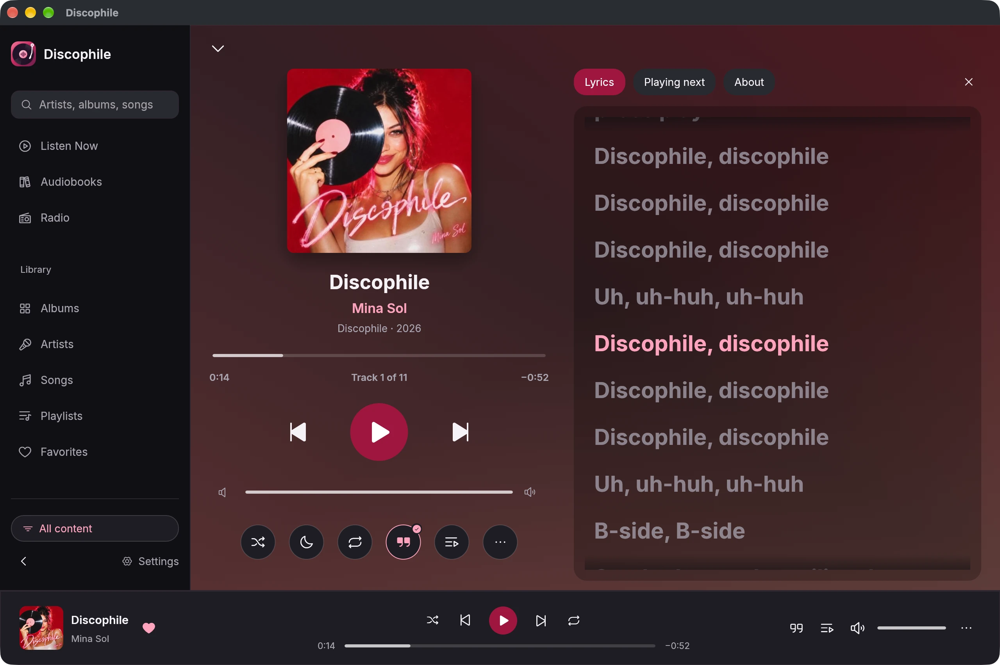
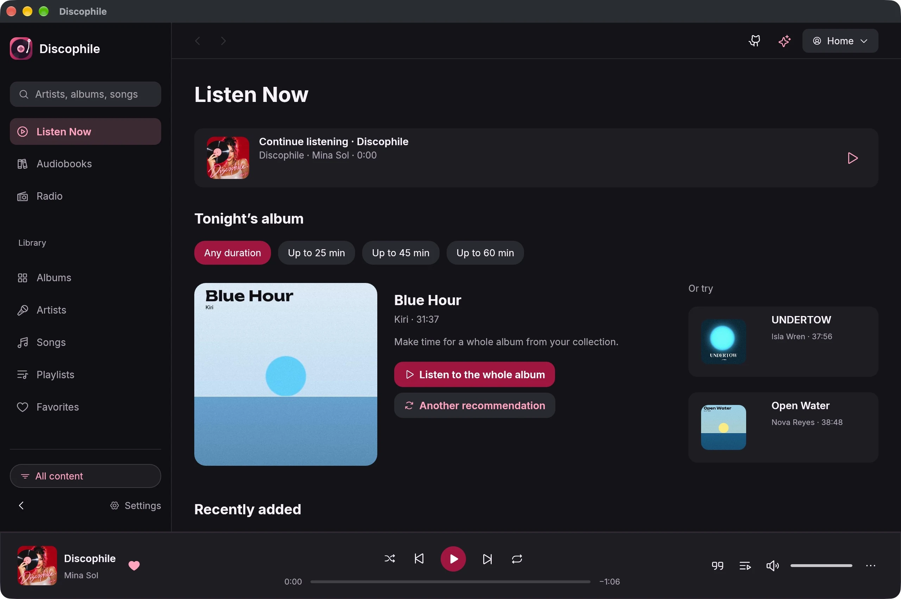
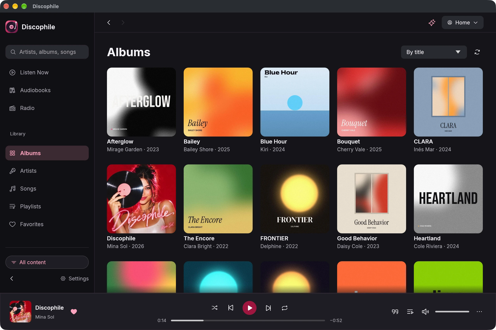
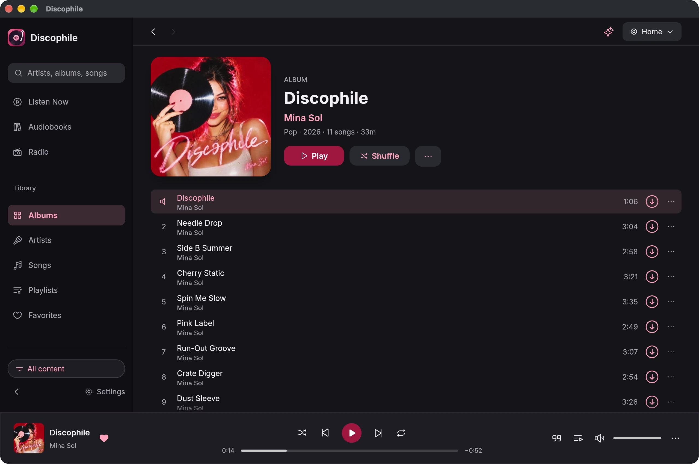
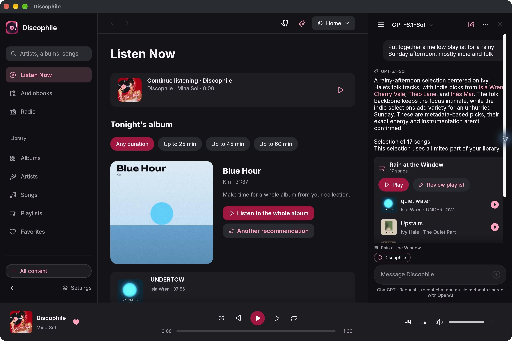
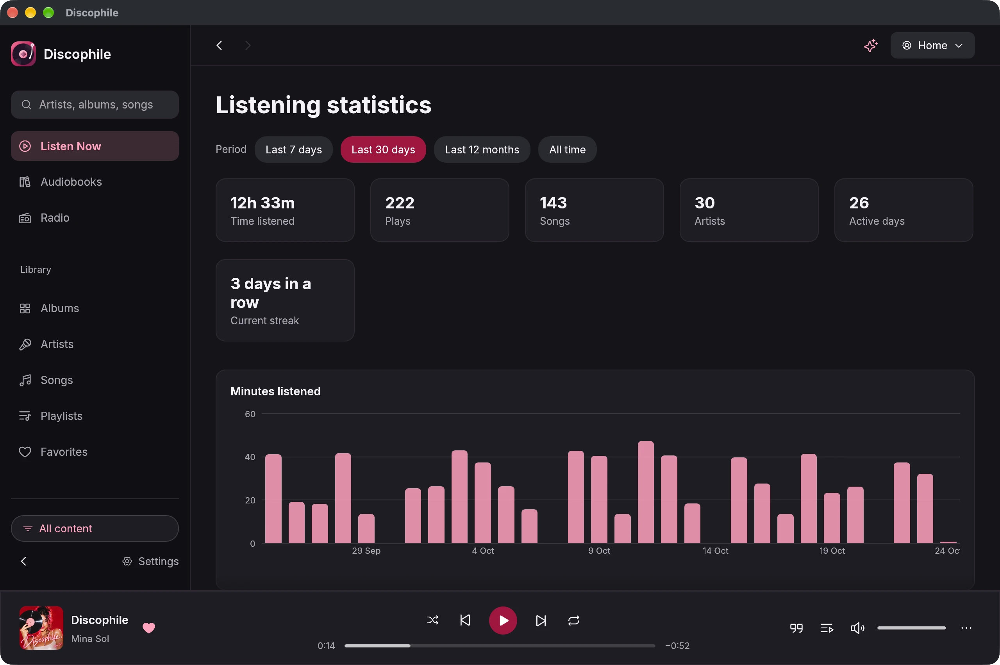
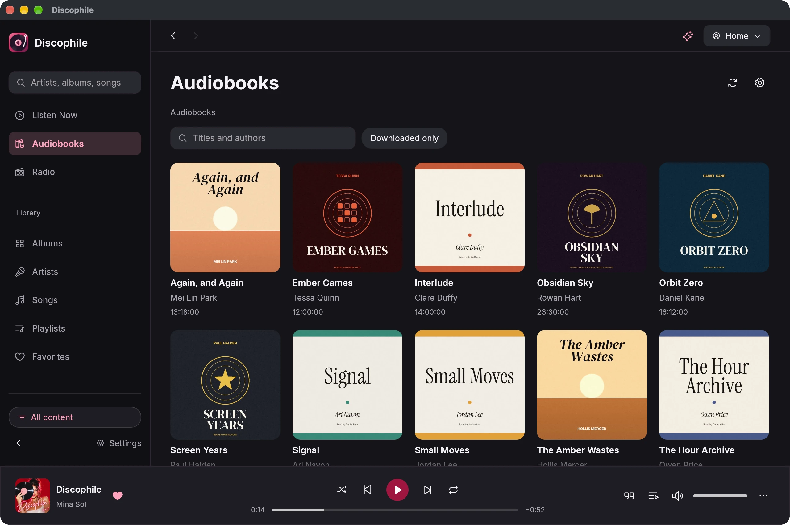
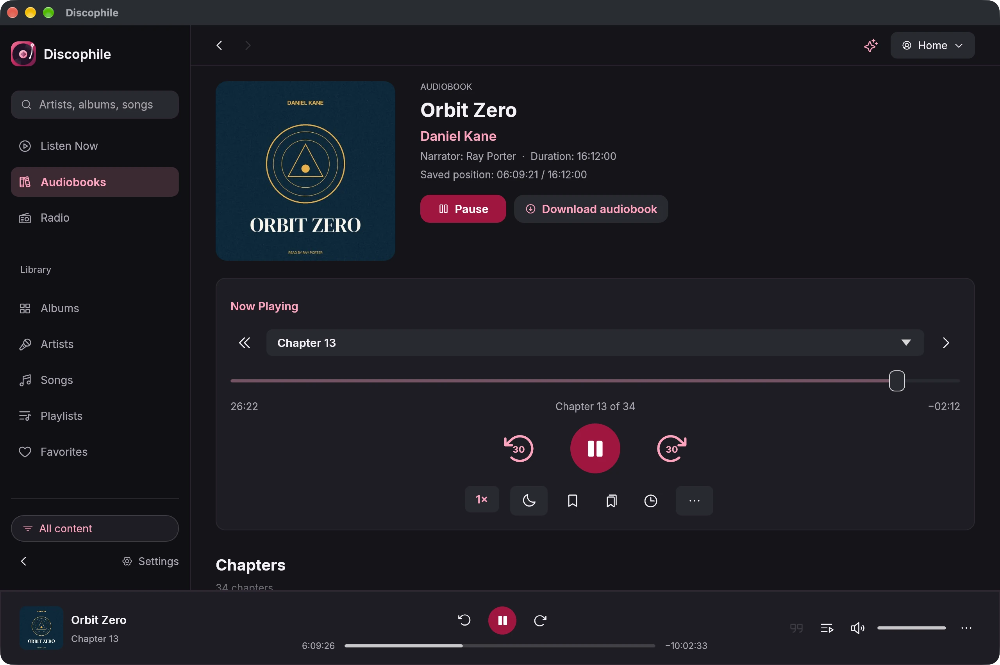
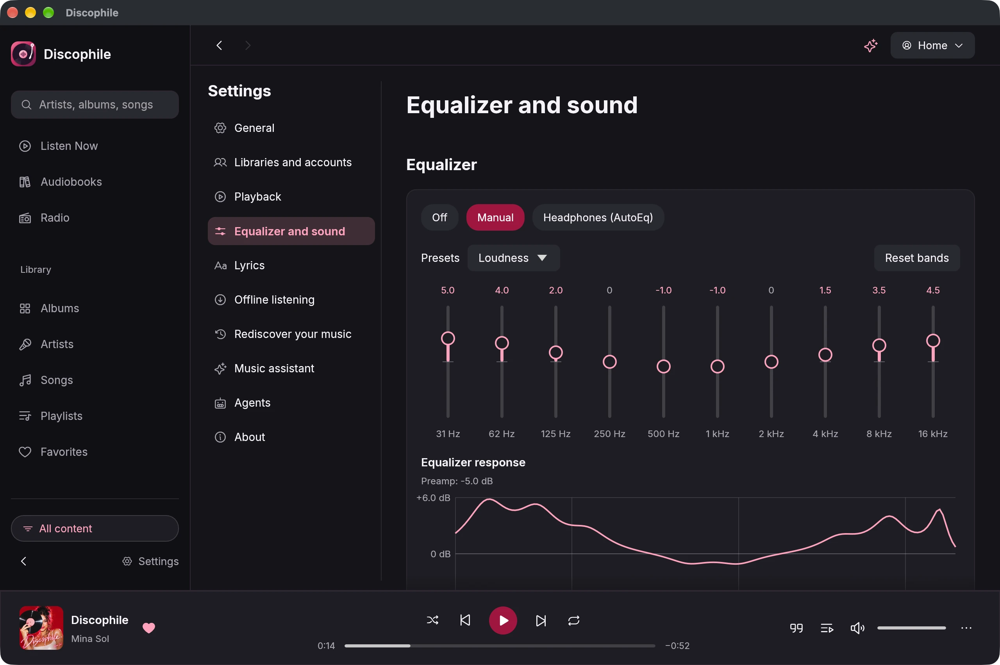

<p align="center">
  
</p>

<h1 align="center">Discophile</h1>

<p align="center">
  <strong>Your music server, played like a record collection.</strong><br>
  A desktop player for Navidrome, Subsonic and Jellyfin, with your Audiobookshelf audiobooks<br>
  and internet radio in the same window. For macOS, Windows and Linux, and in the browser.
</p>

<p align="center">
  <a href="https://github.com/debba/discophile/releases/latest"></a>
  <a href="docs/WEB.md"></a>
  
  <a href="LICENSE"></a>
</p>

<p align="center">
  <a href="#download">Download</a> ·
  <a href="https://discophile.app">Website</a> ·
  <a href="#features">Features</a> ·
  <a href="#privacy">Privacy</a> ·
  <a href="#build-from-source">Build from source</a>
</p>

<p align="center">
  <picture><source media="(prefers-color-scheme: light)" srcset="docs/screenshots/light/now-playing.webp"></picture>
</p>

Discophile connects to the music you already host and makes it feel like a collection again: mixes built
from your own listening, whole albums picked for the time you have, synced lyrics, a ten-band equalizer, and
a music assistant that only suggests songs you can play right now. A Discophile Connect account is optional; there is no tracking or analytics. The app talks to your servers and to nothing else unless you turn it on.

## Works with

| Music | Audiobooks | Radio |
| --- | --- | --- |
| [Navidrome](https://www.navidrome.org), [Subsonic and OpenSubsonic](https://opensubsonic.netlify.app) servers, [Jellyfin](https://jellyfin.org) | [Audiobookshelf](https://www.audiobookshelf.org) | Any internet radio stream, no account needed |

Add several libraries, give each a name, and switch between them from the toolbar. Each library keeps its own
history, caches and downloads.

## Features

### Listen Now

Mixes from your own history on this computer. **Worth another listen** brings back songs you haven't played in a
month, **Still to discover** finds the ones you never played, and **Have 25 minutes?** fills a short break.
**Choose a record for tonight** suggests three whole albums for 25, 45 or 60 minutes and plays the one you pick
from first track to last. Pick up where you left off, even after a restart.

<p align="center">
  <picture><source media="(prefers-color-scheme: light)" srcset="docs/screenshots/light/listen-now.webp"></picture>
</p>

### Your whole library

Albums, artists, songs, playlists, favorites and podcasts, with search across everything from the sidebar.
Create and edit playlists without duplicates, subscribe to podcasts from an Apple Podcasts or Spotify link or an
RSS feed, and download songs, albums, playlists or podcasts for offline listening. Switch on **Downloaded only**
and every view shows just what is saved on this computer.

<table>
  <tr>
    <td><picture><source media="(prefers-color-scheme: light)" srcset="docs/screenshots/light/albums.webp"></picture></td>
    <td><picture><source media="(prefers-color-scheme: light)" srcset="docs/screenshots/light/album.webp"></picture></td>
  </tr>
</table>

### Now Playing and lyrics

A full-window player tinted by the artwork, with the queue, synced lyrics and an **About** panel beside it.
Lyrics follow the song and jump to a line when you click it. They come from your server (OpenSubsonic, Subsonic
or Jellyfin), with optional [LRCLIB](https://lrclib.net) lookups. Shuffle, repeat, a sleep timer and personal
radio (*Stay with this style* or *Let me explore*, with "Why this song?") are one click away. Media keys and the
system controls work too: Now Playing on macOS, the media overlay on Windows, MPRIS on Linux.

### A music assistant that knows your library

Describe a mood, an occasion or a question about music. The assistant picks songs from your library, so every
suggestion is playable, and proposes playlists you can play or save. Edits such as removing tracks or renaming
a playlist open a review first: nothing changes on your server until you confirm. Use your ChatGPT account, or
a local OpenAI-compatible model such as [Ollama](https://ollama.com) or LM Studio that never leaves your
computer.

**About** writes an overview of an artist, album, song or podcast on request, grounded in your server's
biographies and album notes and, if you allow it, MusicBrainz and Wikipedia, with the sources linked.

<p align="center">
  <picture><source media="(prefers-color-scheme: light)" srcset="docs/screenshots/light/assistant.webp"></picture>
</p>

### Listening statistics

Time listened, plays, songs, artists, active days and your current streak for the last 7 days, 30 days,
12 months or all time, with your top songs, artists, albums and genres. Statistics are computed on this computer from
your own history.

<p align="center">
  <picture><source media="(prefers-color-scheme: light)" srcset="docs/screenshots/light/statistics.webp"></picture>
</p>

### Audiobooks

Connect Audiobookshelf next to your music, or on its own. Chapter and book timelines, 30-second skips, speed
from 0.5× to 4×, a sleep timer that can stop at the end of the chapter, bookmarks, and whole books downloaded
for offline listening. Your position syncs with the server, so you can move between devices without hunting for
your place.

<table>
  <tr>
    <td><picture><source media="(prefers-color-scheme: light)" srcset="docs/screenshots/light/audiobooks.webp"></picture></td>
    <td><picture><source media="(prefers-color-scheme: light)" srcset="docs/screenshots/light/audiobook-player.webp"></picture></td>
  </tr>
</table>

### Sound

A ten-band equalizer with presets and a live response curve, or headphone correction from
[AutoEq](https://github.com/jaakkopasanen/AutoEq) with ParametricEQ import. ReplayGain in track, album or
automatic mode with clipping prevention, a volume limit, gapless playback, and crossfade from 1 to 12 seconds
that stays gapless inside an album.

<p align="center">
  <picture><source media="(prefers-color-scheme: light)" srcset="docs/screenshots/light/equalizer.webp"></picture>
</p>

### And also

- **Agents.** An optional [Model Context Protocol](https://modelcontextprotocol.io) server lets agents such as
  Claude Code or Claude Desktop search your library, build playlists and control playback. It listens only on
  this computer, needs a token, and asks you before anything is removed.
- **At home on every desktop.** A tray menu with playback controls and close-to-tray, a full macOS menu bar
  with shortcuts (⌘1 to ⌘0 for sections, ⌘F to search), light and dark appearance, and adjustable text size.
- **Accessible.** Controls are labeled for screen readers, with visible focus for keyboard use.
- **English and Italian**, following your system language or your choice.
- **Updates.** A compact launch notification and a toolbar icon offer new versions. Click **Install and restart** to
  download, verify and install the update. After restarting, a Markdown changelog shows the merged PRs
  included in the release, including versions you skipped.

## Download

Get the latest version from [Releases](https://github.com/debba/discophile/releases/latest).

| System | File | Notes |
| --- | --- | --- |
| macOS 11 or later | `Discophile-<version>-macos-universal.dmg` | Apple silicon and Intel. Signed and notarized: open the disk image and drag Discophile to Applications. |
| Windows 10 or later | `Discophile-<version>-windows-x86_64.zip` | Extract and run `Discophile.exe`. |
| Debian / Ubuntu (x86_64) | `discophile_<version>_amd64.deb` | Install with `sudo apt install ./discophile_<version>_amd64.deb`. |
| Linux AppImage (x86_64) | `Discophile-<version>-x86_64.AppImage` | Make executable and launch. Requires glibc 2.35+. Without FUSE use `--appimage-extract-and-run`. |
| Linux archive (x86_64) | `Discophile-<version>-linux-x86_64.tar.gz` | Needs ALSA or PipeWire/PulseAudio and D-Bus. Includes a `.desktop` file and icon. |
| Arch Linux | [`discophile-bin`](https://aur.archlinux.org/packages/discophile-bin) on the AUR | `yay -S discophile-bin` or `paru -S discophile-bin`. |

Automatic updates require a writable installation folder (and the installed `.app` on macOS). System-managed
Linux packages should be updated with their package manager. Dismissing the notification leaves the update icon
available for the rest of the session. GitHub is linked from the bottom of the sidebar and **Settings → About**.

**Web player.** The same app runs in the browser, self-hosted with Docker or Kubernetes. The image can also
serve your servers from the player's own address, so you don't have to configure CORS:

```sh
docker run -d -p 8080:8080 -e DISCOPHILE_PROXY_NAVIDROME=http://192.168.1.20:4533 ghcr.io/debba/discophile-web
helm install discophile oci://ghcr.io/debba/charts/discophile-web
```

See [Self-hosting the web player](docs/WEB.md) for Docker Compose, Helm values, HTTPS and CORS. The browser
version cannot download for offline listening or sign in to ChatGPT, and keeps credentials in the browser's
storage.

**Also on iPhone.** Discophile started as an iPhone app; see [discophile.app](https://discophile.app).

## Privacy

Discophile works without any account and collects nothing. The optional [Discophile Connect](docs/CONNECT.md)
account is used only after you sign in. Pairing and synchronization are separately enabled in Settings; selected configurations and playback messages are encrypted before transmission. Passwords and tokens are stored in your system's
keychain (Keychain on macOS, Credential Manager on Windows, Secret Service on Linux, or a file only you can read
when no keychain is available), and your listening history stays on your computer.

The app contacts other services only for features you use, and only with what they need:

| Feature | What is sent | To |
| --- | --- | --- |
| Online lyrics (off by default) | Title, artist, album and duration of the song | [LRCLIB](https://lrclib.net) |
| Podcast directory | The search text or link | Apple Podcasts |
| Headphone correction | Nothing personal: the AutoEq list and the chosen profile are downloaded | GitHub |
| ChatGPT | Your request, the recent conversation and limited song metadata (title, artist, album, genre, year) under temporary IDs, with `store: false` | OpenAI |
| Local model | Everything stays with the server address you configure | Your model server |
| Online music information (off by default) | The name, title and artist of the item you open in About | MusicBrainz, Wikipedia |
| Updates and changelogs | Release metadata, and packages/checksums when you install; the user agent carries the app version. Automatic update checks can be turned off. | GitHub |
| Agents (off by default) | Library metadata, to the agent you connect on this computer | The agent and its model provider |
| Discophile Connect (optional) | When you choose an instance or sign in: the sign-in through your browser, then requests for your account name, email address and plan. After pairing: encrypted selected connection settings, optional language/appearance, configuration snapshots and playback messages. Audio files are never sent to Connect. | The Connect instance you choose (`connect.discophile.app` by default) |

## Build from source

Discophile is written in Rust with [egui](https://github.com/emilk/egui). You need Rust 1.88 or later. On Linux,
also install the ALSA and D-Bus development packages (`libasound2-dev` and `libdbus-1-dev` on Debian and Ubuntu).

```sh
cargo run --release -p discophile        # the desktop app
```

For the web player, add the `wasm32-unknown-unknown` target and install [trunk](https://trunkrs.dev):

```sh
cd crates/app && trunk serve             # http://127.0.0.1:8080
cd crates/app && trunk build --release   # static files in dist/
```

To self-host the web player with Docker or Helm, see [docs/WEB.md](docs/WEB.md). To change the Discophile Connect
instance, sign in or sign out, see [docs/CONNECT.md](docs/CONNECT.md). Tests, project layout, releases
and how the screenshots are made are in
[docs/DEVELOPMENT.md](docs/DEVELOPMENT.md). The architecture is described in
[docs/ARCHITECTURE.md](docs/ARCHITECTURE.md).

## Support

Found a bug or have an idea? [Open an issue](https://github.com/debba/discophile/issues).
If Discophile is useful to you, you can support its development on
[GitHub Sponsors](https://github.com/sponsors/debba).

## License

[MIT](LICENSE) © Andrea Debernardi.
Fonts: [Inter](https://rsms.me/inter/) (SIL Open Font License) and [Phosphor](https://phosphoricons.com) icons
(MIT). Screenshots show a demo library of fictional artists, albums and books.
